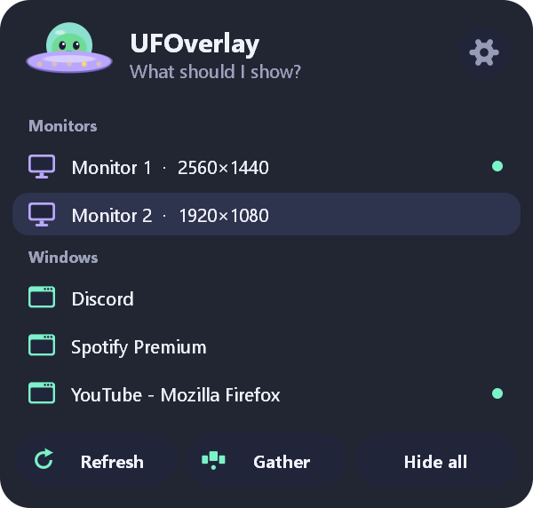
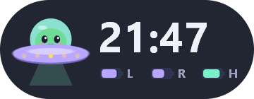
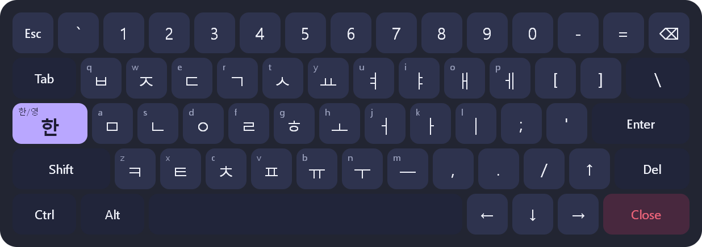

<p align="center">
  
</p>

<h1 align="center">UFOverlay</h1>
<p align="center">모니터와 창을 VR 안에 띄워 주는 작은 SteamVR 오버레이예요.<br>
몇 가지만 잘하고, 게임에 방해되지 않는 걸 목표로 해요.</p>
<p align="center"><a href="README.md">English</a></p>

<p align="center">
  
  
</p>

> 아직 초기 단계의 개인 프로젝트예요. 제 환경에서는 잘 돌아가지만 여러 환경에서
> 충분히 테스트하지는 못했어요. 버그 제보나 의견은 언제든 환영해요.

## 할 수 있는 것

- **모니터와 창을 VR 패널로.** 모니터나 앱 창을 골라 눈앞에 띄워요. SteamVR 대시보드 밖에서 써요.
- **자유롭게 배치.** 그립으로 옮기고, 스틱으로 앞뒤로 보내고, 두 손으로 잡아 크기를 조절해요. 패널을 잠그면 보기 전용이 돼요.
- **마우스와 키보드.** 컨트롤러로 클릭·드래그·우클릭·스크롤을 할 수 있고, 입력기(한/영, あ/A)를 따라가는 VR 키보드가 있어요.
- **손목 시계.** 손등에 시계와 배터리가 있고, 손등을 볼 때 나타나요. 누르면 메뉴가 열려요.
- **소소한 편의 기능.** 창을 반대 손에 달고 다니기, 패널을 앞으로 모으기, 다음 실행 때 배치 복원.
- **한국어 · 日本語 · English.** 다른 언어와 키보드 배열은 TOML 파일로 추가할 수 있어요.

<p align="center">
  
  &nbsp;
  
</p>
<p align="center"></p>

## 가볍게 유지하기

게임하는 동안 자원을 최대한 적게 쓰는 게 목표예요. 실행 파일은 약 680KB이고, 게임 엔진·브라우저·UI 프레임워크 없이 스레드 하나로 돌아요.

제 컴퓨터에서 잰 값이에요(RTX 4060 노트북, 2560×1440 @ 240Hz 화면, release 빌드). 환경마다 다를 수 있어요.

| 상태 | CPU | 메모리 |
|---|---|---|
| 아무것도 안 띄움, 시계 숨김 | 초당 약 2–3ms | 약 50MB |
| 아무것도 안 띄움, 시계 보임 | 초당 약 6ms | 약 50MB |
| 모니터 패널 1개, 안 가리키는 중 | 초당 약 11ms | 약 58MB |
| 패널을 가리키는 중 | 초당 약 32ms | 약 58MB |

메모리는 대부분 그래픽 드라이버가 차지해요. 주요 방식은 이래요.

- 캡처한 화면은 GPU 안에만 두고 그대로 SteamVR에 넘겨요.
- 바뀐 게 없으면 다시 그리지 않고, 가리키지 않는 패널은 느리게 갱신해요.
- 포인터 판정과 잡은·붙인 패널은 매 프레임 SteamVR을 호출하지 않아요.
- SteamVR에 들어 있는 `openvr_api.dll`을 써서 SDK 빌드가 필요 없어요.

## 설치

필요한 것: Windows 10(1903 이상) 또는 11, SteamVR, Direct3D 11 그래픽카드.

1. [Releases](https://github.com/soumt-r/UFOverlay/releases)에서 zip을 받아 아무 곳에나 풀어요.
2. SteamVR을 켠 뒤 `ufoverlay.exe`를 실행해요.
3. SteamVR과 함께 켜려면: 메뉴 → ⚙ → **SteamVR와 함께 켜기**.

## 조작

| 동작 | 방법 |
|---|---|
| 메뉴 열기 | 왼손등의 시계를 보고, 오른손으로 가리켜 트리거 |
| 모니터 / 창 띄우기 | 메뉴에서 선택 |
| 클릭 / 드래그 | 패널을 가리키고 트리거 |
| 우클릭 | B (왼손은 Y) |
| 스크롤 | 가리킨 채 스틱 위/아래 |
| 패널 옮기기 | 가리키고 그립을 쥔 채 이동, 놓으면 고정 (옮기는 동안 손 쪽을 바라봐요) |
| 앞뒤로 보내기 | 그립을 쥔 채 스틱 위/아래 |
| 크기 조절 | 한 손으로 잡은 패널을 다른 손도 그립, 두 손 간격으로 조절 |
| 패널 툴바 | 패널을 가리킬 때 아래에 나타나요: **영상**(최대 속도로 계속 갱신), **키보드**, **손에**(반대 손에 붙이기), **⇄**(이 자리에 다른 모니터·창 띄우기, 이미 열려 있으면 두 패널 자리 교체), **🔒**(보기 전용), **✕** |
| 모으기 / 다 숨기기 | 메뉴 하단 버튼 |
| 시계 옮기기 | 가리키고 그립으로 잡아 놓기 (설정에서 고정 가능) |

UFOverlay를 가리키는 동안 그 손의 트리거·그립·스틱은 게임에 들어가지 않아요. 설정에서 끌 수 있고, 잠근 패널은 게임 입력을 막지 않아요.

## 설정

설정 패널(메뉴 → ⚙)에서 바꾸면 바로 적용돼요: 언어, 갱신 속도, 패널 불투명도·거리, 스크롤·밀기 속도, 손떨림 보정, 게임 입력 막기, 왼손잡이, 시계 크기·24시간제·위치 고정, 시작 애니메이션, SteamVR와 함께 켜기, 관리자 권한 창 조작.

같은 값이 exe 옆 `ufoverlay.ini`에 저장돼요. 패널 배치는 `layout.txt`, 로그는 `ufoverlay.log`, 컨트롤러 바인딩은 `input/`에 있어요(SteamVR 컨트롤러 설정에서 바꿀 수 있어요).

**관리자 권한 창:** Windows는 일반 앱이 관리자 권한 창에 입력하는 걸 막아요. 이 옵션을 켜면 **PC 화면에** UAC 창이 한 번 떠요(VR 안에는 보이지 않아요). 승인하면 작업 스케줄러 항목을 통해 관리자 권한으로 다시 실행되고, 이후로는 묻지 않아요. 끄면 그 항목을 지워요.

## 언어와 키보드 배열

UI 문구와 키보드 배열은 [`i18n/`](i18n/)의 TOML 파일이에요. exe 옆 `i18n/lang/`이나 `i18n/keyboards/`에 파일을 넣고 재시작하면 다시 빌드하지 않아도 추가돼요. 형식은 [i18n/README.md](i18n/README.md)에 있어요. 기존 번역을 고쳐 주시는 것도 환영해요.

## 소스에서 빌드

```powershell
cargo build --release        # target\release\ufoverlay.exe
cargo test
```

Rust(MSVC 툴체인)만 있으면 되고, 버전은 `rust-toolchain.toml`에 고정돼 있어요. 개발용 옵션과 에셋 재생성 방법은 [README.md](README.md#build-from-source)에 있어요.

## 알려진 한계

- 지금까지 주로 Virtual Desktop + Quest 컨트롤러로 테스트했어요. Index 바인딩은 들어 있지만 거의 테스트하지 못했어요.
- 패널은 평면이고 아직 자유롭게 회전할 수 없어요.
- UI 크기와 시계 기본 위치가 모든 헤드셋이나 손 크기에 맞지는 않을 수 있어요.
- 고개를 많이 들거나 숙였을 때(누웠을 때 등) 메뉴와 새 패널이 시선 방향에 떠요. 새로 넣은 동작이라 조정이 필요할 수 있어요.

## 라이선스

MIT, [LICENSE](LICENSE) 참고. 서드파티 구성요소(Valve OpenVR 헤더 BSD-3-Clause, windows-rs MIT)는 [THIRD_PARTY_NOTICES.md](THIRD_PARTY_NOTICES.md)에 있고, 모든 릴리스에 함께 들어가요.

Valve Corporation과 관계없는 독립 프로젝트예요. SteamVR은 Valve Corporation의 상표예요.
