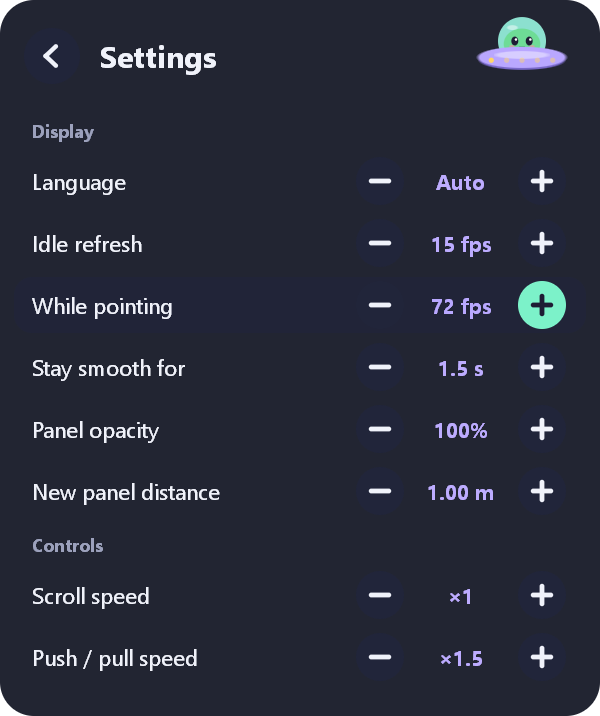

<p align="center">
  
</p>

<h1 align="center">UFOverlay</h1>
<p align="center"><b>Ultra Fast Overlay</b> — SteamVR용 초경량 데스크톱·창 오버레이.<br>
꼭 필요한 기능만, 보고 있지 않을 땐 아무것도 돌지 않게.</p>
<p align="center"><a href="README.md">English</a></p>

<p align="center">
  
  
</p>

## 기능

- **모니터와 창을 VR 패널로** — 모니터든 앱 창이든 골라서 눈앞에 띄워요. SteamVR 대시보드 밖에서 써요.
- **잡고, 옮기고, 밀고, 키우기** — 그립으로 옮기고, 스틱으로 앞뒤로 보내고, 두 손으로 잡아 크기 조절.
- **진짜 마우스·키보드** — 컨트롤러로 클릭·드래그·우클릭·스크롤. 입력기(한/영, あ/A)를 따라가는 VR 키보드 내장.
- **손목 시계** — 손등 위에 시계와 배터리. 진짜 시계처럼 손등을 볼 때만 나타나고, 누르면 메뉴가 열려요.
- **손에 붙이기 · 모으기 · 배치 기억** — 작은 창을 반대 손에 달고 다니고, 흩어진 패널을 앞으로 모으고, 다음 실행 때 배치를 그대로 복원.
- **한국어 · 日本語 · English** — 언어와 키보드 배열은 TOML 파일로 추가 가능.

<p align="center">
  
  &nbsp;
  
</p>
<p align="center"></p>

## 가볍게 만든 방식

실행 파일은 약 **680KB**예요. 게임 엔진, 브라우저, UI 프레임워크 없이 스레드 하나와 Direct3D 11 장치 하나로 돌아요.

RTX 4060 노트북, 2560×1440 @ 240Hz 화면, release 빌드 실측:

| 상태 | CPU | 메모리 |
|---|---|---|
| 아무것도 안 띄움, 시계 숨김 | 초당 약 2–3ms (코어 하나의 0.3%) | 약 50MB |
| 아무것도 안 띄움, 시계 보이며 애니메이션 중 | 초당 약 6ms | 약 50MB |
| 모니터 패널 1개, 안 가리키는 중 | 초당 약 11ms | 약 58MB |
| 패널을 가리키는 중 (72fps, 90Hz 입력) | 초당 약 32ms | 약 58MB |

메모리는 대부분 그래픽 드라이버예요.

1. **픽셀이 GPU 밖으로 안 나가요.** Windows.Graphics.Capture 프레임을 GPU 안에서 복사해 SteamVR이 바로 읽어요.
2. **이벤트 기반이에요.** 화면이 안 바뀌면 프레임도, 일도 없어요.
3. **fps가 상황에 맞춰 바뀌어요.** 가리킬 때만 높이고, Windows에도 캡처 속도를 낮춰 달라고 요청해서 240Hz 화면을 초당 240번 복사하지 않아요.
4. **포인터 판정은 로컬 계산이에요.** SteamVR에 묻지 않고 이미 아는 위치로 계산해요.
5. **잡거나 손에 붙인 패널은 컨트롤러 기준으로 띄워요.** 컴포지터가 직접 따라 움직여서 지연이 없어요.
6. **정적인 그림은 바뀔 때만 다시 그려요.** 시계 애니메이션도 볼 때만 돌아요.
7. **OpenVR SDK를 빌드하지 않아요.** SteamVR에 설치된 `openvr_api.dll`을 불러와 함수 테이블로 직접 호출해요.

## 설치

필요한 것: Windows 10 (1903+) 또는 11, SteamVR, Direct3D 11 그래픽카드.

1. **Releases**에서 최신 zip을 받아 아무 곳에나 풀어요.
2. SteamVR을 켠 뒤 `ufoverlay.exe`를 실행해요.
3. 매번 자동으로 켜려면: 메뉴 → ⚙ → **SteamVR와 함께 켜기**.

## 조작

| 동작 | 방법 |
|---|---|
| 메뉴 열기 | 왼손등의 시계를 보고, 오른손으로 가리켜 트리거 |
| 모니터 / 창 띄우기 | 메뉴에서 선택 |
| 클릭 / 드래그 | 패널을 가리키고 트리거 |
| 우클릭 | B (왼손은 Y) |
| 스크롤 | 가리킨 채 스틱 위/아래 |
| 패널 옮기기 | 가리키고 그립을 쥔 채 이동, 놓으면 고정 |
| 앞뒤로 보내기 | 그립을 쥔 채 스틱 위/아래 |
| 크기 조절 | 한 손으로 잡은 패널을 다른 손도 그립, 두 손 간격으로 조절 |
| 패널 툴바 | 패널을 가리킬 때 아래에 나타남: **영상**(최대 fps 유지), **키보드**, **손에**(반대 손에 붙이기), **✕** |
| 모으기 / 다 숨기기 | 메뉴 하단 버튼 |
| 시계 옮기기 | 가리키고 그립으로 잡아 놓기 (위치 저장) |

UFOverlay를 가리키는 동안 그 손의 트리거·그립·스틱은 게임에 들어가지 않아요 (설정에서 끌 수 있음).

## 설정

VR 안 설정 패널(메뉴 → ⚙)에서 바꾸면 바로 적용돼요: 언어, 가만히 볼 때·가리킬 때 fps, 패널 불투명도·거리, 스크롤·밀기 속도, 손떨림 보정, 게임 입력 막기, 왼손잡이, 시계 크기·24시간제, 시작 애니메이션, SteamVR와 함께 켜기, 관리자 권한 창 조작.

같은 값이 exe 옆 `ufoverlay.ini`에 저장돼요. 패널 배치는 `layout.txt`, 로그는 `ufoverlay.log`, 컨트롤러 바인딩은 `input/`(SteamVR 컨트롤러 설정에서 변경 가능)에 있어요.

**관리자 권한 창:** Windows는 일반 앱이 관리자 권한 창에 입력하는 걸 막아요. 이 옵션을 켜면 **PC 화면에** UAC 창이 한 번 떠요(VR 안에는 안 보여요). 승인하면 작업 스케줄러 항목으로 관리자 권한 재실행되고, 이후로는 묻지 않아요. 끄면 그 항목을 지워요.

## 언어와 키보드 배열

UI 문구와 키보드 배열은 [`i18n/`](i18n/)의 표준 TOML 파일이에요. exe 옆 `i18n/lang/`이나 `i18n/keyboards/`에 파일을 넣고 재시작하면 바로 추가돼요. 형식은 [i18n/README.md](i18n/README.md) 참고.

## 소스에서 빌드

```powershell
cargo build --release        # target\release\ufoverlay.exe
cargo test                   # 단위 테스트, 번역·배열 검사
```

Rust(MSVC 툴체인)만 있으면 돼요. C++ 툴체인이나 OpenVR SDK 빌드는 필요 없어요. 개발용 옵션과 에셋 재생성 방법은 [README.md](README.md#build-from-source)에 있어요.

## 알려진 한계

- 지금까지 Virtual Desktop + Quest 컨트롤러로만 테스트했어요. Index 바인딩은 들어 있지만 덜 검증됐어요.
- 패널은 평면이고 아직 자유롭게 회전할 수 없어요.

## 라이선스

MIT — [LICENSE](LICENSE). 서드파티 구성요소(Valve OpenVR 헤더 BSD-3-Clause, windows-rs MIT)는 [THIRD_PARTY_NOTICES.md](THIRD_PARTY_NOTICES.md)에 있고, 모든 릴리스에 함께 들어가요.

Valve Corporation과 관계없는 독립 프로젝트예요. SteamVR은 Valve Corporation의 상표예요.
