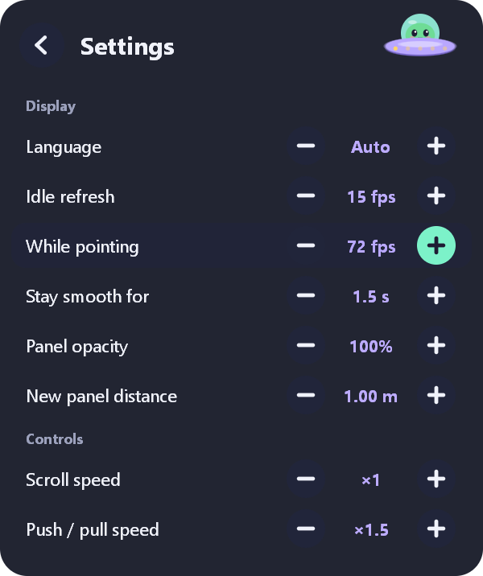
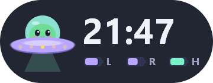
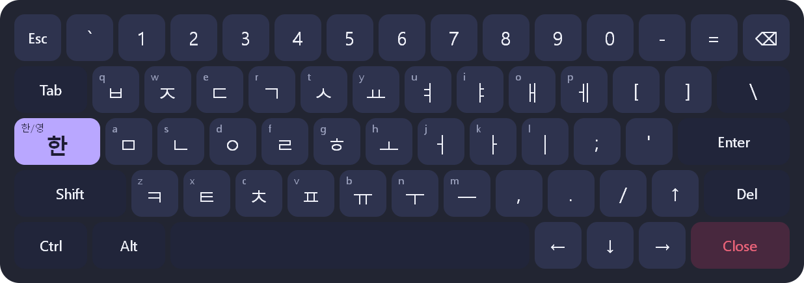

<p align="center">
  
</p>

<h1 align="center">UFOverlay</h1>
<p align="center"><b>Ultra Fast Overlay</b> — a tiny SteamVR desktop & window overlay.<br>
Only the essentials, and nothing running while you're not looking.</p>
<p align="center"><a href="README.ko.md">한국어</a></p>

<p align="center">
  
  
</p>

## What it does

- **Monitors and windows as panels in VR** — pick any monitor or app window and it floats in front of you, outside the SteamVR dashboard.
- **Grab, move, push, zoom** — grip to move a panel, push / pull it with the stick, grip it with both hands to resize.
- **Real mouse & keyboard** — click, drag, right-click and scroll with the controller; a built-in VR keyboard that follows your IME (한/영, あ/A).
- **A watch on your wrist** — clock and batteries on the back of your hand; it appears when you look at it, like a real watch. Tap it for the menu.
- **Pin to hand, gather, remember** — carry a small window on your other hand, pull every panel back in front of you, and get your layout back next time.
- **Korean · Japanese · English**, and more languages and keyboard layouts can be added as plain TOML files.

<p align="center">
  
  &nbsp;
  
</p>
<p align="center"></p>

## Light by design

The executable is about **680 KB**. No game engine, no browser, no UI framework — one thread and one Direct3D 11 device.

Measured on an RTX 4060 Laptop with a 2560×1440 @ 240 Hz desktop (release build):

| State | CPU | Memory |
|---|---|---|
| Nothing open, watch hidden | ~2–3 ms per second (≈0.3 % of one core) | ~50 MB |
| Nothing open, watch visible and animating | ~6 ms per second | ~50 MB |
| One monitor panel, not pointed at | ~11 ms per second | ~58 MB |
| Pointing at a panel (72 fps, 90 Hz input) | ~32 ms per second | ~58 MB |

Memory is mostly the graphics driver. How it stays this light:

1. **Pixels never leave the GPU.** Windows.Graphics.Capture frames are copied GPU-side into a texture SteamVR samples directly.
2. **Event-driven.** An unchanged screen produces no frames and no work; the loop sleeps until a frame arrives or a deadline is due.
3. **Adaptive frame rate.** Panels refresh at a low rate unless you point at them, and Windows is asked to throttle capture itself, so a 240 Hz desktop is never copied 240 times a second.
4. **Pointer hit-testing is local math** on transforms we already know — no round-trips to SteamVR.
5. **Held and pinned panels ride on the controller** in the compositor, so they follow your hand with zero lag and no per-frame updates.
6. **Static images are redrawn only when they change** (menu, toolbar, keyboard), and the watch animates only while you look at it.
7. **OpenVR without an SDK build.** `openvr_api.dll` is loaded from your SteamVR install and called through its flat function tables.

## Install

Requirements: Windows 10 (1903+) or 11, SteamVR, a Direct3D 11 GPU.

1. Download the latest zip from **Releases** and unzip it anywhere.
2. Start SteamVR, then run `ufoverlay.exe`.
3. To start it with SteamVR every time: menu → ⚙ → **Start with SteamVR**.

## Controls

| Do | How |
|---|---|
| Open the menu | Look at the watch on your left hand, point at it with the right controller, pull the trigger |
| Open a monitor / window | Pick it in the menu |
| Click / drag | Point at a panel, trigger |
| Right-click | B (Y on the left hand) |
| Scroll | Point, stick up / down |
| Move a panel | Point, hold grip, move; release to drop it |
| Push away / pull closer | Hold grip, stick up / down |
| Resize | Hold a panel with one hand, grip it with the other, move hands apart / together |
| Panel toolbar | Appears under a panel while you point at it: **Video** (stay at full fps), **Keyboard**, **Pin** (carry it on your other hand), **✕** |
| Gather / hide all | Menu buttons at the bottom |
| Move the watch | Point at it, grip, place it; the spot is saved |

While you point at UFOverlay, that hand's trigger, grip and stick are kept from the game (can be turned off in Settings).

## Settings

Everything is in the in-VR settings panel (menu → ⚙) and applies immediately: language, idle / pointing frame rates, panel opacity and spawn distance, scroll and push speed, jitter smoothing, input blocking, left-handed mode, watch size and 24-hour clock, startup animation, start with SteamVR, and controlling admin windows.

The same values live in `ufoverlay.ini` next to the exe. Panel layout is saved in `layout.txt`, logs in `ufoverlay.log`, controller bindings in `input/` (rebindable in SteamVR's controller settings).

**Admin windows:** Windows blocks input from normal apps into elevated windows. Turning this option on shows one UAC prompt **on your PC screen** (it can't appear in VR); after that UFOverlay restarts elevated through a Task Scheduler entry, without further prompts. Turning it off removes the entry.

## Languages and keyboard layouts

UI text and keyboard layouts are standard TOML files in [`i18n/`](i18n/). Drop a new file into `i18n/lang/` or `i18n/keyboards/` next to the exe and restart — no rebuild. See [i18n/README.md](i18n/README.md) for the format and key names.

## Build from source

```powershell
cargo build --release        # target\release\ufoverlay.exe
cargo test                   # unit tests, translation and layout checks
```

Needs Rust (MSVC toolchain). No C++ toolchain or OpenVR SDK build is required.

Developer flags: `--spawn` (open the primary monitor), `--spawn-window <title>`, `--spawn-aim` (panel where the right controller points — moves the real mouse), `--no-layout`, `--ime-test`.

Regenerating assets: `cargo test make_icons -- --ignored` (icon) and `cargo test docs_images -- --ignored` (these screenshots), then `python tools/compress_png.py docs/images` / `python tools/compress_icons.py`. `tools/gen_fntable.py` regenerates the OpenVR function-table indices from `vendor/openvr_capi.h`.

<details>
<summary>Source layout</summary>

```
src/main.rs      loop, panels, hands, menu, settings, keyboard, watch, layout
src/capture.rs   D3D11 + Windows.Graphics.Capture
src/vr/          OpenVR function-table wrapper (fntable.rs is generated)
src/ui.rs        drawing: toolbar, menu, settings, keyboard, watch, mascot
src/text.rs      GDI text rendering (per-language fonts)
src/input.rs     SendInput: mouse, wheel, keys, window focus
src/ime.rs       read / switch the focused window's IME
src/i18n.rs      language packs        src/kbd.rs       keyboard layouts
src/tinytoml.rs  small TOML reader     src/settings.rs  settings rows
src/layout.rs    panel layout file     src/elevate.rs   admin-windows option
src/sources.rs   monitor / window list src/math.rs      vectors, transforms, ray hits
input/           SteamVR Input actions + default bindings (Quest, Index)
i18n/            language packs and keyboard layouts (TOML)
```
</details>

## Known limitations

- Only tested with Quest controllers over Virtual Desktop so far; Index bindings are included but less tested.
- Panels are flat (no curvature) and can't be rotated freely yet.

## License

MIT — see [LICENSE](LICENSE). Third-party components (Valve's OpenVR header, BSD-3-Clause; windows-rs, MIT) are listed in [THIRD_PARTY_NOTICES.md](THIRD_PARTY_NOTICES.md), which ships with every release.

UFOverlay is an independent project, not affiliated with or endorsed by Valve Corporation. SteamVR is a trademark of Valve Corporation.
