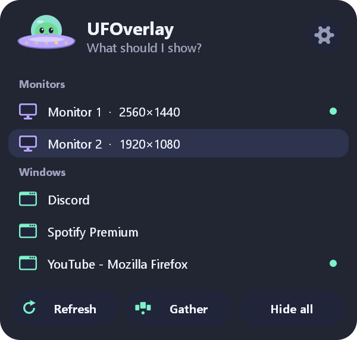

<p align="center">
  
</p>

<h1 align="center">UFOverlay</h1>
<p align="center">A small SteamVR overlay for your monitors and windows.<br>
It tries to do a few things well and stay out of the way.</p>
<p align="center"><a href="README.ko.md">한국어</a></p>

<p align="center">
  
  
</p>

> UFOverlay is an early hobby project. It works well on my setup, but it has
> only been tested on a few machines — bug reports and feedback are very welcome.

## What it does

- **Monitors and windows as panels in VR.** Pick a monitor or an app window and it floats in front of you, outside the SteamVR dashboard.
- **Move them around.** Grip to move a panel, push / pull it with the stick, grip it with both hands to resize. Lock a panel to make it view-only.
- **Mouse and keyboard.** Click, drag, right-click and scroll with the controller. There is a VR keyboard that follows your input method (한/영, あ/A).
- **A watch on your wrist.** Clock and batteries on the back of your hand; it shows up when you look at it. Tap it to open the menu.
- **Small conveniences.** Carry a window on your other hand, gather all panels in front of you, and get your layout back next time.
- **Korean, Japanese and English.** Other languages and keyboard layouts can be added as TOML files.

<p align="center">
  
  &nbsp;
  
</p>
<p align="center"></p>

## Keeping it light

The goal is to use as little as possible while you're playing: the
executable is about 680 KB and runs on a single thread without a game engine,
browser or UI framework.

Numbers from my machine (RTX 4060 Laptop, 2560×1440 @ 240 Hz desktop, release
build). Yours will differ:

| State | CPU | Memory |
|---|---|---|
| Nothing open, watch hidden | ~2–3 ms per second | ~50 MB |
| Nothing open, watch visible | ~6 ms per second | ~50 MB |
| One monitor panel, not pointed at | ~11 ms per second | ~58 MB |
| Pointing at a panel | ~32 ms per second | ~58 MB |

Most of the memory is the graphics driver. The main ideas:

- Captured frames stay on the GPU and are handed to SteamVR as textures.
- Nothing is redrawn when nothing changes; panels refresh slowly unless you point at them.
- Pointer hit-testing and held / pinned panels avoid per-frame calls to SteamVR.
- OpenVR is used through the `openvr_api.dll` that comes with SteamVR, so no SDK build is needed.

## Install

Requirements: Windows 10 (1903 or later) or 11, SteamVR, a Direct3D 11 GPU.

1. Download the zip from [Releases](https://github.com/soumt-r/UFOverlay/releases) and unzip it anywhere.
2. Start SteamVR, then run `ufoverlay.exe`.
3. To start it together with SteamVR: menu → ⚙ → **Start with SteamVR**.

## Controls

| Do | How |
|---|---|
| Open the menu | Look at the watch on your left hand, point at it with the right controller, pull the trigger |
| Open a monitor / window | Pick it in the menu |
| Click / drag | Point at a panel, trigger |
| Right-click | B (Y on the left hand) |
| Scroll | Point, stick up / down |
| Move a panel | Point, hold grip, move; release to drop it (it turns to face your hand while you carry it) |
| Push away / pull closer | Hold grip, stick up / down |
| Resize | Hold a panel with one hand, grip it with the other, move your hands apart / together |
| Panel toolbar | Shows under a panel while you point at it: **Video** (keep refreshing at full speed), **Keyboard**, **Pin** (carry it on your other hand), **⇄** (show another monitor / window here; if it's already open, the two panels swap places), **🔒** (view only), **✕** |
| Gather / hide all | Buttons at the bottom of the menu |
| Move the watch | Point at it, grip, place it (can be locked in Settings) |

While you point at UFOverlay, that hand's trigger, grip and stick are kept from the game. This can be turned off in Settings, and locked panels never block the game.

## Settings

The settings panel (menu → ⚙) applies changes right away: language, refresh rates, panel opacity and distance, scroll and push speed, jitter smoothing, input blocking, left-handed mode, watch size / 24-hour clock / position lock, startup animation, starting with SteamVR, and controlling admin windows.

The same values are stored in `ufoverlay.ini` next to the exe. The panel layout is saved in `layout.txt`, logs go to `ufoverlay.log`, and controller bindings are in `input/` (they can be changed in SteamVR's controller settings).

**Admin windows:** Windows doesn't let normal apps send input to elevated windows. If you turn this option on, one UAC prompt appears **on your PC screen** (it can't be shown in VR). After that UFOverlay restarts elevated through a Task Scheduler entry and won't ask again. Turning the option off removes the entry.

## Languages and keyboard layouts

UI text and keyboard layouts are TOML files in [`i18n/`](i18n/). You can drop a new file into `i18n/lang/` or `i18n/keyboards/` next to the exe and restart, without rebuilding. [i18n/README.md](i18n/README.md) explains the format. Corrections to the existing translations are welcome too.

## Build from source

```powershell
cargo build --release        # target\release\ufoverlay.exe
cargo test
```

You only need Rust (MSVC toolchain); the version is pinned in `rust-toolchain.toml`.

Developer flags: `--spawn` (open the primary monitor), `--spawn-window <title>`, `--spawn-aim` (panel where the right controller points; this moves the real mouse), `--no-layout`, `--ime-test`.

Regenerating assets: `cargo test make_icons -- --ignored` (icon) and `cargo test docs_images -- --ignored` (these screenshots), then `python tools/compress_png.py docs/images` / `python tools/compress_icons.py`. `tools/gen_fntable.py` regenerates the OpenVR function-table indices from `vendor/openvr_capi.h`.

<details>
<summary>Source layout</summary>

```
src/main.rs      loop, panels, hands, menu, settings, keyboard, watch, layout
src/capture.rs   D3D11 + Windows.Graphics.Capture
src/vr/          OpenVR function-table wrapper (fntable.rs is generated)
src/ui.rs        drawing: toolbar, menu, settings, keyboard, watch, mascot
src/text.rs      GDI text rendering (per-language fonts)
src/input.rs     SendInput: mouse, wheel, keys, window focus
src/ime.rs       read / switch the focused window's IME
src/i18n.rs      language packs        src/kbd.rs       keyboard layouts
src/tinytoml.rs  small TOML reader     src/settings.rs  settings rows
src/layout.rs    panel layout file     src/elevate.rs   admin-windows option
src/sources.rs   monitor / window list src/math.rs      vectors, transforms, ray hits
input/           SteamVR Input actions + default bindings (Quest, Index)
i18n/            language packs and keyboard layouts (TOML)
```
</details>

## Known limitations

- So far it has mainly been tested with Quest controllers over Virtual Desktop. Index bindings are included but have seen little testing.
- Panels are flat (no curvature) and can't be rotated freely yet.
- The UI scale and default watch position may not suit every headset or hand size yet.
- When you look far up or down (e.g. lying down), menus and new panels open where you're looking; this is new and may need tuning.

## License

MIT, see [LICENSE](LICENSE). Third-party components (Valve's OpenVR header, BSD-3-Clause; windows-rs, MIT) are listed in [THIRD_PARTY_NOTICES.md](THIRD_PARTY_NOTICES.md), which is included in every release.

UFOverlay is an independent project, not affiliated with or endorsed by Valve Corporation. SteamVR is a trademark of Valve Corporation.
